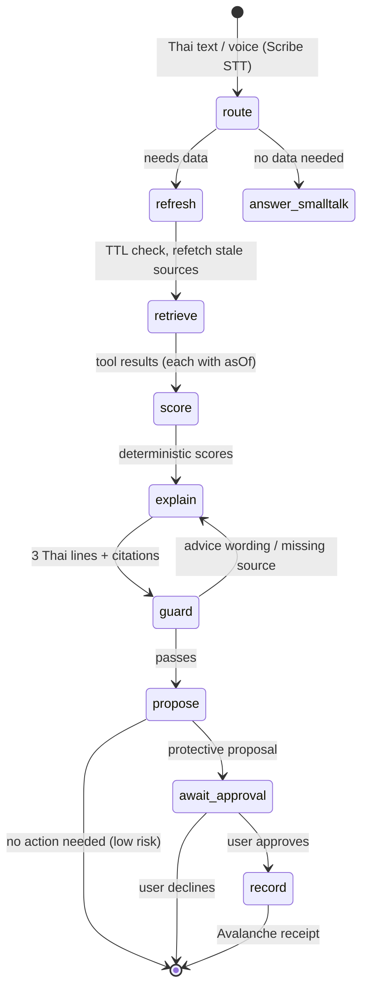
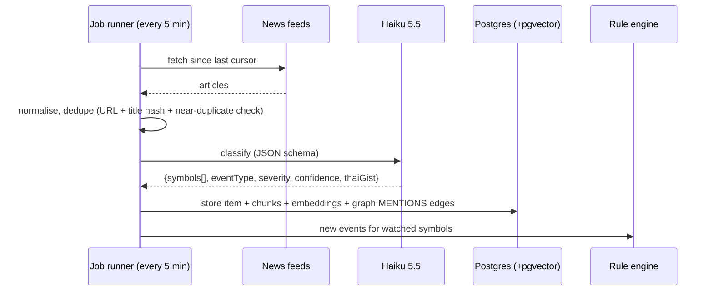

# U-Guard · Agentic AI Workflow v2

How U-Guard's agents should work once it watches global market news and portfolio drift as well as token unlocks: what is new, which models do which job, whether to use LangChain / LangGraph, which kinds of RAG, and how to keep every alert and every consultation on fresh data.

> Written 15 Oct 2026 (hackathon day 1). Builds on what already runs (see [SPEC.md](SPEC.md) §5–§8 and [LOGS.md](LOGS.md)).
> U-Guard gives decision support, not investment advice (Thai SEC licence rules). Everything below keeps that line.

---

## 0. Short answers

| Question | Answer |
|---|---|
| What is new in v2? | Three watchers (supply, market news, portfolio drift) feed one alert engine. Every consultation re-fetches live data and cites its sources with an "as of" time. A small investor graph explains shared exposure across tokens. Section 1. |
| Which models? | **Claude Opus 5.5** for the consultation agent, **Claude Haiku 5.5** for high-volume news triage and routing, **Claude Sonnet 5.5** as the cheaper consultation option, **Voyage** embeddings + reranker for news search, **ElevenLabs** for Thai voice. Risk scores stay deterministic code, not a model. Section 3. |
| LangChain / LangGraph? | **Not for the hackathon.** Our plain Anthropic SDK loop already does tool use, caching, effort and fallbacks, and has a deterministic offline twin. Model the workflow as an explicit graph in code so it ports cleanly. Adopt **LangGraph.js** (or Claude Managed Agents) later, when approvals must pause for hours and resume durably. Section 4. |
| Other frameworks? | A durable job runner for ingest and alerts (**Inngest** or **Trigger.dev**, or **Vercel Cron** for the demo), **Supabase Postgres + pgvector** for data, vectors and the graph, and an eval harness. Section 4. |
| Which RAG? | Mostly **not vector RAG**: numbers come from **structured tool calls**. **Agentic RAG** on top (the agent picks sources, re-queries, cites). **Hybrid vector RAG** only for unstructured text (news, announcements, governance, research, regulation). **GraphRAG-lite** (Postgres graph) for investor and recipient links. Section 5. |
| Always-fresh data? | A **freshness contract**: every tool returns `asOf`, `source`, `ttl` and `stale`. TTL caches per source, **fetch-on-ask** for every consultation, scheduled ingest for alerts, and answers that say how old each number is. Sections 6–9. |

---

## 1. What is new in v2

| | v1 (built today) | v2 (this design) |
|---|---|---|
| What it watches | Token unlocks for the user's holdings | Unlocks **+ market news + macro calendar + portfolio drift** |
| When it acts | When the user asks, or taps "scan" | When asked **and** on its own: scheduled checks and event triggers raise alerts |
| Data | Tokenomist fixtures + live price | Live sources behind TTL caches; each number carries `asOf` and a source |
| Retrieval | Tool calls for structured data | Tool calls + agentic news search with citations + investor graph |
| Portfolio | Weight, unlock risk, 6-month dilution | + drift from the user's target mix, portfolio risk score, concentration, volatility |
| Alerts | Rules stored in memory, no delivery | Rule engine with dedupe, cooldown, quiet hours, morning brief; delivered through U-Bot (LINE / Telegram later) |
| Explanation | 3 Thai lines + voice | Same, plus citations and "ข้อมูล ณ HH:MM" on every number |
| Actions | Protective proposals → approve → Avalanche receipt | Same, plus rule-based actions the user set up (pause DCA, alert before unlock); still never "buy X" |
| Quality | Manual testing | Golden-question evals: number fidelity, citations, freshness, no advice wording |

**Pitch line:** U-Guard stops being a checker you have to remember to ask and becomes a guard that watches for you. It still never moves money without your approval.

---

## 2. Architecture

```mermaid
flowchart LR
  subgraph Sources
    TK[Tokenomist<br/>unlocks, allocations, funding]
    PX[Prices<br/>CoinGecko / exchange WS]
    NW[News feeds<br/>+ Claude web search]
    MC[Macro calendar<br/>FOMC, CPI, rates]
    WL[U-topia wallet<br/>Avalanche RPC]
  end
  subgraph Ingest["Scheduled ingest (job runner)"]
    I1[pull + normalise]
    I2[dedupe]
    I3[Haiku: tag token, event type, severity]
    I4[embed news]
  end
  subgraph Store["Supabase Postgres"]
    T1[(structured tables<br/>+ TTL cache)]
    T2[(news chunks<br/>pgvector)]
    T3[(entity graph<br/>nodes / edges)]
  end
  subgraph Watch["Watchers → alert engine"]
    W1[supply watcher]
    W2[news watcher]
    W3[drift watcher]
    AE[rules · dedupe · cooldown · quiet hours]
    AC[Haiku/Sonnet: 3 Thai lines + citations]
  end
  subgraph Consult["Consultation agent (on ask)"]
    OR[Orchestrator<br/>Opus 5.5]
    TL[tools: structured · news search · graph · web search]
    SC[deterministic scorers]
  end
  Sources --> Ingest --> Store
  Store --> Watch
  W1 & W2 & W3 --> AE --> AC --> UB[U-Bot inbox / push]
  UB --> User((User))
  User -->|asks / taps alert| OR
  OR <--> TL
  TL <--> Store
  TL <-->|fetch-on-ask| Sources
  OR --> SC
  OR -->|proposal| User
  User -->|approve| AV[Avalanche receipt]
```



### Agents and their jobs
Use **one orchestrator with specialists as tools**, not a swarm of chatting agents. Fewer moving parts and easier to trace on stage.

| Agent / component | Model | Does | Never does |
|---|---|---|---|
| **Orchestrator (consultation)** | Opus 5.5 (effort low → medium) | Understands the Thai question, plans tool calls, writes the 3-line answer with citations, drafts protective proposals | Make up numbers; recommend buying or selling |
| **News triage** (background) | Haiku 5.5 | Tags each article: tokens, event type, severity, confidence, language; writes a 1-line Thai gist | Decide alone to alert (rules decide) |
| **Alert composer** | Haiku 5.5 (Sonnet 5.5 for high severity) | Turns a fired rule + fresh data into 3 Thai lines + sources | Send without a rule firing |
| **Scorers** | none (TypeScript) | Unlock risk score, drift, concentration, volatility | Use an LLM |
| **Compliance guard** | Haiku 5.5 + regex | Checks the final text for advice wording ("ควรซื้อ", "ควรขาย", price targets) and missing sources/dates | Rewrite facts |
| **Action executor** | none (code + user approval) | Records approved rules on Avalanche Fuji | Act without an explicit approval |

### The consultation workflow as a graph
Written as plain TypeScript today; each node maps 1:1 to a LangGraph node if we adopt it later.



---

## 3. Models per job

Prices are per million tokens (input / output) from Anthropic's model catalog, Oct 2026.

| Job | Model | Why | Settings |
|---|---|---|---|
| Consultation agent (tool use, Thai reasoning) | `claude-opus-5-5` ($4 / $20) | Best multi-step tool use and Thai at a moderate price; what v1 already uses | effort `low` for chat, `medium` for portfolio reviews; cache the system prompt and tools; server-side fallback on |
| Cheaper consultation (scale-up) | `claude-sonnet-5-5` ($2 / $10) | Half the price, 1M context; good enough for most single-token questions | A/B against Opus on the eval set before switching |
| News triage, routing, extraction, alert text, compliance check | `claude-haiku-5-5` ($0.10 / $0.50 under 100K prompt) | Built for high-volume classification and sub-agent work | structured outputs (JSON schema); effort `low` |
| Deep weekly report (optional) | `claude-fable-5-1` ($10 / $50) | Highest capability; only for rare, long jobs | Not needed for the demo |
| Reading screenshots and charts | Claude vision (same models) | "Import my portfolio from an exchange screenshot", or read a chart a user sends in chat | Treat extracted numbers as user-provided; confirm before use |
| On-demand web news | Claude server tools `web_search_20260209` + `web_fetch_20260209` | Fresh results with citations, no index to maintain; dynamic filtering keeps context small | Cap `max_uses`; consider an allowed-domains list |
| Embeddings (news, docs) | Voyage **voyage-4** or **voyage-4-lite** | Multilingual (Thai + English news), 32K context; sizes share one embedding space, so you can switch without re-indexing | 1024 dims; check current model names and prices on Voyage's site |
| Reranking | Voyage **rerank-2.5** / **rerank-2.5-lite** | Improves top-k after hybrid search | Rerank top 50 → keep 8 |
| Thai speech to text | ElevenLabs Scribe (`scribe_v1`, `language_code: "th"`) | Already wired at `/api/stt` | Browser th-TH fallback |
| Thai text to speech | ElevenLabs `eleven_v3` | Already wired at `/api/voice` | Browser fallback |
| Risk, drift, volatility | **No model**: TypeScript formulas | Auditable, explainable, same answer every time; required to stay out of "advice" | Unit-tested |

**Not recommended:** price-prediction models (TimesFM, Chronos and similar). A price forecast reads as advice and would undercut the compliance story. Forecast **supply**, which is scheduled, not price.

**Option to test:** Anthropic's advisor tool (beta) pairs a cheap executor (Haiku / Sonnet) with a stronger advisor (Opus) that plans mid-answer. It could cut consultation cost. Check which model pairs it supports before relying on it.

**Rough cost per consultation** (Opus 5.5, ~10K input with cached system prompt and tools, ~600 output): about **$0.05**. **News triage** at 1,000 articles/day × ~1K tokens on Haiku 5.5: about **$0.10–0.20/day**.

---

## 4. Frameworks: LangChain, LangGraph, or not

### Recommendation
| Phase | Use | Don't use (yet) |
|---|---|---|
| **Hackathon (now → Fri demo)** | Anthropic TypeScript SDK + our own tool registry and loop (`src/lib/agent/*`), Vercel Cron or a "run watchers" button, Supabase if approved | LangChain, LangGraph, multi-agent frameworks |
| **After the hackathon** | A durable job runner (Inngest or Trigger.dev) for ingest and alerts, and **LangGraph.js** *or* **Claude Managed Agents** for long-running, resumable agents | Rewriting working code just to use a framework |

### Why not LangChain / LangGraph now
1. **Our loop is small and already works.** ~80 lines, with Claude-specific features wrappers often lag behind: prompt caching, `effort`, server-side fallback, strict tool schemas, server tools (web search), thinking-block rules.
2. **The offline twin.** `offline.ts` calls the same tools without an LLM, so the demo survives a network or API failure. That is easiest to keep in plain TypeScript.
3. **Time.** About one working day is left. A new framework costs learning and debugging time, and the judges score execution and practicality, not framework choice.
4. **The flow is mostly fixed.** route → refresh → score → explain → guard → propose → approve is a short graph with one loop. A plain state machine is clear and easy to show in the agent trace.

### When LangGraph (JS) becomes worth it
- **Approvals that wait.** A user gets an alert at 08:00 and approves at 13:00. LangGraph's `interrupt()` pauses a node, a Postgres checkpointer stores the state under a `thread_id`, and `Command({ resume })` continues. Note: on resume the node **re-runs from the top**, so code before `interrupt()` must have no side effects, and the Avalanche write must be idempotent.
- **Long-running monitors** with retries, branching, and many specialist nodes.
- **Time-travel debugging and tracing** (LangSmith) once traffic is real.

### Other options worth knowing
| Tool | Fits U-Guard for | Notes |
|---|---|---|
| **Claude Managed Agents** | The scheduled **morning brief** agent and weekly portfolio review | Anthropic runs the loop and sandbox; **scheduled deployments** take a cron expression and IANA timezone (e.g. `0 8 * * *`, `Asia/Bangkok`); has memory stores and outcomes (rubric-graded runs). Beta. |
| **Inngest / Trigger.dev** | News ingest every 5 min, alert evaluation, retries, fan-out per user | Durable steps that fit a Next.js app; pick one |
| **Vercel Cron** | Demo-grade schedules | Simplest; no retries or state |
| **Supabase** (Postgres, pgvector, `pg_cron`, Realtime) | Tables, vectors, graph and cron in one place; Realtime pushes new alerts to the UI | Already the planned DB (ask before creating the project) |
| **LangSmith / Langfuse** | Tracing and evals | Optional; our JSONL run log plus the eval script cover the hackathon |

---

## 5. Retrieval: which kinds of RAG

The key point: **most of what U-Guard needs is numbers, and numbers must never come from vector search.** Embedding an unlock table and retrieving "similar chunks" can return the wrong month or the wrong token. Numbers come from typed tools; RAG is only for text.

| Kind | Use it for | How | Status |
|---|---|---|---|
| **Structured retrieval (tools)**: the primary path | Unlock schedules, allocations, funding rounds, prices, volume, holdings, user rules, target mix | Fixed, parameterised tools (`get_unlock_schedule`, `get_allocations`, `get_portfolio`, …). Each returns JSON with `asOf`, `source`, `ttl`, `stale`. No free-form text-to-SQL. | ✅ v1 tools; add the freshness fields |
| **Agentic RAG**: how the agent uses all sources | Every consultation | The orchestrator decides which tools and searches it needs, checks whether it has enough, re-queries if not, and cites. Budget: max ~8 tool calls per answer. | ✅ loop exists; add news tools + citation rule |
| **Hybrid vector RAG** | News, project announcements, governance proposals, research reports, Thai SEC rules | Chunk (~400 tokens) → Voyage embeddings → **pgvector** + keyword search → filter by `symbols`, `published_at`, `source` → rerank → top 8 with URLs | ⬜ after the hackathon (use Claude web search until then) |
| **GraphRAG-lite** (knowledge graph) | Questions about links, not text: shared investors, recipients, exposure | Postgres `nodes` / `edges` tables + recursive queries, exposed as tools | ⬜ seed from `screener.json`, allocations and fundraising (~1 hour) |
| **Temporal weighting** | Keeping old news from outranking new | `score × exp(−age / halfLife)`; half-life ~2 days for news, ~14 for governance, ~180 for docs; hard cut-offs per question type | ⬜ with vector RAG |

### Why GraphRAG-lite, and what it answers
Vector search finds *similar text*. A graph answers *who is connected to what*, which is the real risk question for unlocks:
- "Which of my tokens share a lead investor that unlocks this month?" (Investors often sell several positions in the same window.)
- "How much of my portfolio goes to VCs or the team in the next 30 days?"
- "Which recipients of this unlock moved tokens to exchanges after past unlocks?" (needs on-chain data later)

```
(Token)-[:HAS_ALLOCATION]->(Allocation {class: team|investor|ecosystem…})
(Investor)-[:INVESTED_IN {round, date, amount}]->(Token)
(Token)-[:UNLOCKS {date, amount, recipientClass}]->(UnlockEvent)
(NewsItem)-[:MENTIONS]->(Token | Investor)
(User)-[:HOLDS {weight}]->(Token)
```

New tools: `investor_exposure(userId)` and `related_unlocks(symbol, days)`.
Full "Microsoft-style" GraphRAG (LLM-built community summaries over a large corpus) is overkill here. Revisit it only for clustering news into narratives.

### Thai-specific note
Postgres full-text search does not split Thai words (Thai has no spaces), so keyword search on Thai text works poorly. Most market news is English, so: keyword search on English text, embeddings for cross-language matching (a Thai question finds English news), and filter on token symbols, which are language-neutral. Let the LLM write the Thai.

### Retrieved text is data, not instructions
News articles and web pages can contain prompt injection ("ignore previous instructions…"). Wrap retrieved text in clearly marked blocks. The system prompt says it is untrusted, and nothing retrieved can trigger an action: proposals still need the user's tap.

---

## 6. Freshness: keeping data current

### The freshness contract
Every tool result carries:

```ts
interface Fresh<T> {
  data: T;
  source: "tokenomist" | "coingecko" | "news:<feed>" | "web_search" | "avalanche" | "fixture";
  asOf: string;        // when the source produced it (ISO)
  fetchedAt: string;   // when we got it
  ttlSeconds: number;  // how long it may be reused
  stale: boolean;      // fetchedAt + ttl < now, or the source failed and we fell back
}
```

Rules for the agent (system prompt + code):
1. **Fetch on ask.** Each new user question calls tools again. Never answer a number from earlier in the conversation. Old tool results are pruned from the context, either by our code or the context-editing beta (`clear_tool_uses`).
2. **Say the age.** Every number in the answer is followed by its time ("ราคา ณ 14:05", "ข้อมูล unlock ณ 15 ต.ค."). The UI shows "อัปเดต x นาทีที่แล้ว".
3. **Stale means say so.** If `stale` is true, the answer says the data may be out of date and which source failed. It never guesses.
4. **Sample data stays labelled** (`source: "fixture"`), as today.

### TTL per source
| Data | Source | Refresh | TTL for answers |
|---|---|---|---|
| Price, 24h volume | CoinGecko now; exchange WebSocket later | on ask; every 1 min for watched tokens | 60 s |
| Upcoming unlocks (all tokens) | Tokenomist `/v5/unlock/events/upcoming` | every 1 h | 1 h |
| Unlock schedule per token | Tokenomist `/v5/unlock/events/{id}` | daily + on ask if older than 24 h | 24 h |
| Allocations, funding rounds | Tokenomist | weekly | 7 d |
| Market news | feeds + Claude web search | every 5 min (ingest); on ask (web search) | 15 min |
| Macro calendar (FOMC, CPI) | official calendars, FRED | daily | 24 h |
| Holdings | U-topia wallet / Avalanche RPC | on ask; every 5 min for alert users | 60 s |
| User rules, target mix | our DB | on change | live |

### News and macro sources (check terms before building)
| Source | What | Notes |
|---|---|---|
| Claude `web_search` / `web_fetch` | On-demand news with citations | Simplest for the demo; per-search cost; no index needed |
| CryptoPanic API | Aggregated crypto headlines | Third-party guides say the free tier ended in early 2026; check plans |
| CoinDesk Data (ex-CCData / CryptoCompare) | News + market data | Contact-based pricing; reportedly an internal-use licence, so check display rights before showing articles to users |
| Benzinga Crypto News API | Real-time crypto news | Pricing not public |
| Project blogs, exchange announcements (RSS) | Listings, delistings, migrations, incidents | Free; per-source parsers |
| GDELT | Global news events (macro, geopolitics) | Free; noisy, needs filtering |
| FRED, central-bank calendars | Rates, CPI, FOMC dates | Free |

### Freshness and the hackathon demo
Venue Wi-Fi can fail. Keep the fixture fallback, and make the stale label visible on stage. Showing "ข้อมูลอาจไม่ล่าสุด (Tokenomist ไม่ตอบ) · ณ 15 ต.ค. 13:00" is better than a silent wrong number, and it proves the contract works.

---

## 7. Market news pipeline



**Event types:** `unlock_change` (rescheduled or resized), `exploit_hack`, `listing`, `delisting`, `regulatory`, `governance_vote`, `treasury_move`, `macro` (FOMC / CPI / rates), `partnership`, `other`.
**Severity** comes from Haiku, but a **high** alert also needs either a trusted source (an allow-list) or two independent sources. One blog post can't trigger a high alert.

---

## 8. Portfolio drift

"Drift" means how far the portfolio has moved from what the user intended, plus how its supply risk has changed. All metrics are deterministic.

| Metric | Formula | Default threshold | Example message (Thai, 3 lines) |
|---|---|---|---|
| **Allocation drift** per asset | `dᵢ = wᵢ − tᵢ` (current weight − target weight) | `|dᵢ| > 5` percentage points, or > 25% of the target | "ARB ตอนนี้ 40% ของพอร์ต เกินเป้าที่คุณตั้งไว้ 30%…" |
| Total drift | `½ Σ |dᵢ|` | > 10% | |
| **Portfolio unlock-risk score** | `Σ wᵢ × riskScoreᵢ` (risk-free assets score 0) | crosses 40, or rises by ≥ 10 since the last check | |
| **Dilution drift** | Weighted 6-month dilution `Σ wᵢ × dilutionᵢ` (already computed in `/api/portfolio/risk`) | > 5% | |
| **Concentration** | top weight; HHI `Σ wᵢ²` | top > 40% or HHI > 0.30 | |
| **Volatility / drawdown** (information) | 30-day realised volatility; drawdown from the 30-day high | shown, not alerted, in v2 | |
| **DCA plan check** | planned vs actual buys (incl. ones paused by U-Guard rules) | a missed or paused buy | |

**Target mix:** the user sets it at onboarding ("USDC 30 / ARB 30 / WLD 20 / AVAX 20") or picks a template (careful / balanced). Without a target, U-Guard only reports concentration, risk and dilution, not "drift".

**Compliance:** drift alerts describe the gap from **the user's own** plan and offer **the user's own** rule actions ("เตือนเมื่อเกินกรอบ", "พัก DCA เข้า ARB จนถึงหลัง unlock"). They never say "sell ARB" or "buy AVAX".

New tool: `check_portfolio_drift(userId) → Fresh<{ rows[{symbol, weight, target, drift}], totalDrift, riskScore, dilution, concentration }>`.

---

## 9. Alerts engine

### Rule types
| Type | Example | Evaluated |
|---|---|---|
| Time-to-unlock | "Holdings with a high-risk unlock in ≤ 7 / 3 / 1 days" | hourly |
| Threshold | drift > band; portfolio risk ≥ 40; a token's risk crosses a level | after each price/portfolio refresh |
| News event | high-severity event that mentions a held token | on ingest |
| Market move | price −10% in 1h; volume ×3 vs 7-day average | every minute for held tokens |
| Digest | **Morning brief** at 08:00 Bangkok: today's unlocks, overnight news on holdings, drift | daily (cron, or a Managed Agents scheduled deployment) |

### Flow
1. **Detect**, deterministically: SQL / TypeScript checks against fresh data. No LLM decides whether to alert.
2. **Dedupe and throttle:** one alert per (user, token, type) per cooldown (e.g. 12h); quiet hours 22:00–07:00 except high severity; max ~5 alerts/day, the rest roll into the brief.
3. **Enrich:** call the same tools as a consultation (fresh fetch) so the alert and the follow-up chat show the same numbers.
4. **Compose:** Haiku (Sonnet for high) writes 3 Thai lines + sources + "ณ HH:MM". The compliance guard checks the wording.
5. **Deliver:** U-Bot inbox / push (`src/lib/ubot.ts` adapter), later LINE / Telegram; voice on open (ElevenLabs).
6. **Follow-up:** tapping the alert opens a consultation pre-filled with the alert. It re-fetches, so if the data changed since the alert, it says so.
7. **Act:** a protective proposal → user approves → Avalanche receipt, as in v1.

### Tables (Supabase)
```
alert_rules(id, user_id, type, symbol?, params jsonb, channel, enabled, created_at)
alert_events(id, rule_id, user_id, fired_at, payload jsonb, severity, delivered_at, opened_at, dedupe_key unique)
target_allocations(user_id, symbol, target_pct)
portfolio_snapshots(user_id, taken_at, holdings jsonb, risk_score, drift)
news_items(id, url unique, source, published_at, title, lang, symbols text[], event_type, severity, confidence, gist_th)
news_chunks(id, item_id, chunk, embedding vector(1024))
graph_nodes(id, kind, key, props jsonb) · graph_edges(src, dst, kind, props jsonb)
source_cache(key, data jsonb, source, as_of, fetched_at, ttl_seconds)
```
All tables with RLS (per-user rows), as planned in SPEC §9.

---

## 10. Build plan

Now is Thu 15 Oct ~14:30. Thu runs until 18:00; Fri 10:00 until the afternoon demo. Ordered by demo value per hour:

| # | Step | Time | Demo moment |
|---|---|---|---|
| 1 | Real keys: Anthropic, Tokenomist snapshot, ElevenLabs, Fuji | 45 min | "This is live, not a mock-up" |
| 2 | Freshness contract in all tools + "ณ HH:MM" in cards + stale label | 45 min | Ages on every number |
| 3 | `search_news` with Claude web search (on demand, citations) + citation rule in the prompt | 1 h | "Any news that affects my ARB?" answered with sources |
| 4 | Target mix fixture + `check_portfolio_drift` tool + drift card | 1.5 h | "Your ARB is 40%, target 30%, and it unlocks tomorrow" |
| 5 | Alert engine v0: rules (in memory or Supabase), `/api/watch/run` (Vercel Cron + a button), U-Bot inbox delivery, dedupe | 1.5 h | Alert arrives in U-Bot on stage |
| 6 | GraphRAG-lite: investor graph from `screener.json` + `investor_exposure` tool | 1 h | "3 of your tokens share investors" |
| 7 | Golden-question eval script (~20 Thai questions): number fidelity, citations, no advice wording | 45 min | Confidence before the demo |
| 8 | Morning brief (cron) with voice | 45 min | Optional closer |
| After | News ingest + Voyage + pgvector; LangGraph.js or Managed Agents for long-lived approvals; LINE / Telegram; exchange WebSockets | | |

**Cut line:** if time runs short, stop after step 5. Steps 1–5 already show "watches for you, explains with sources, you approve".

---

## 11. Guardrails and evaluation

**Guardrails**
- Numbers only from tool results. The eval checks every number in the answer against the tool outputs.
- No advice: the compliance guard blocks "ควรซื้อ / ควรขาย / ราคาเป้าหมาย"-style wording and price predictions.
- Every answer has sources + "as of" times, and sample data is labelled.
- Retrieved text is untrusted; nothing retrieved can trigger an action.
- Human-in-the-loop for every action; Fuji testnet only (`chainId` 43113 enforced); idempotent writes.
- Rate limits and quiet hours on alerts (alarm fatigue is a failure too).

**Evaluation (before the demo)**
| Check | How |
|---|---|
| Right tools | Expected tool sequence per golden question (e.g. ARB buy → `lookup_token`, `get_unlock_schedule`, `assess_unlock_risk`, `propose_protection`) |
| Number fidelity | Every number in the reply appears in a tool result (± rounding) |
| Freshness | Reply contains an "as of" time for each data type it uses |
| Citations | News claims carry a URL |
| Compliance | Regex + Haiku judge: no buy/sell/price-target wording |
| Calm when safe | AVAX-type cases produce no proposal |

---

## 12. Questions for mentors and sponsors
1. **U-topia / U-Bot:** can a sub-agent push notifications into U-Bot, and receive the user's holdings with consent? Is there a webhook spec?
2. **Tokenomist:** can we get a hackathon key that includes upcoming unlocks? Are there webhooks for unlock changes, or should we poll?
3. **ElevenLabs:** recommended Thai voice and model for short alerts; any streaming TTS limits?
4. **Avalanche:** is a Fuji self-transfer memo enough as a "protection receipt", or would they rather see a tiny contract event?
5. **Judges:** does a scheduled or automatic alert count as "agentic" for U-Bot integration, or do they want to see the U-Bot orchestrator call us?

---

## Sources
- Anthropic model catalog and API reference (Claude API skill, Oct 2026): model IDs and prices, server tools `web_search_20260209` / `web_fetch_20260209`, advisor tool (beta), Managed Agents scheduled deployments.
- LangGraph interrupts and checkpointers: [futureagi.com](https://futureagi.com/blog/what-is-langgraph-2026/), [rentierdigital.xyz](https://rentierdigital.xyz/blog/human-in-the-loop-langgraph), [neurals.ca](https://neurals.ca/tech/langchain/langgraph/interrupts/) (third-party; confirm against the official LangGraph.js docs)
- Voyage models: [Azure AI catalog: voyage-4](https://ai.azure.com/catalog/models/voyage-4-embedding-model), [OpenRouter: Voyage AI](https://openrouter.ai/voyageai) (check Voyage's own docs for current names and prices)
- News APIs: [CoinMarketCap: CoinDesk API alternatives 2026](https://coinmarketcap.com/api/resources/coindesk-api-alternatives-7-crypto-data-feeds-compared-in-2026), [CoinDesk Data rebrand](https://data.coindesk.com/press-releases/coindesk-unveils-strategic-rebrand-of-ccdata-to-coindesk-data), [Benzinga Crypto News API](https://www.benzinga.com/apis/cloud-product/crypto-news-api), [dltHub: CryptoPanic](https://dlthub.com/context/source/cryptopanic)
- Unlock price behaviour: Keyrock unlock study (16,000+ events), as cited in [PLAN.md](PLAN.md)
