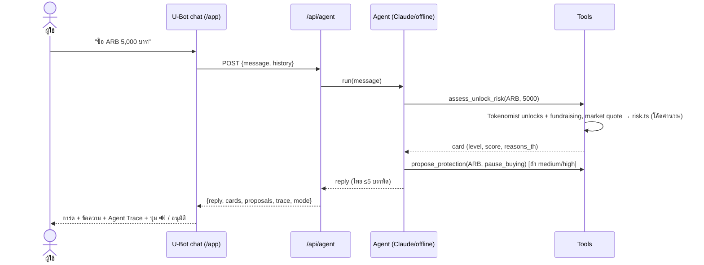

# U-Guard: System Specification (เอกสารหลักสำหรับส่งต่องาน)

> อัปเดต 15 ต.ค. 2026 · ทีม U-Hackathon 2026 (AI Track)
> เอกสารนี้คือ **แหล่งความจริงหลัก (source of truth)** ใครมาต่องาน (คนหรือ AI session ใหม่) อ่านไฟล์นี้ก่อน
> รายละเอียดเสริม: [PLAN.md](PLAN.md) (ปัญหา, หลักฐาน, timeline, pitch) · [UI-PLAN.md](UI-PLAN.md) (หน้าเว็บ, nav, auth, loader)

---

## 0. TL;DR

- **U-Guard** คือ agent ใน U-Bot ที่**เช็กความเสี่ยงจาก supply (token unlock / emission) ก่อนเงินของผู้ใช้ขยับ** อธิบายเป็นภาษาไทย 3 บรรทัดพร้อมเสียง แล้วให้ผู้ใช้**อนุมัติเองทุกครั้ง** (บันทึกการอนุมัติบน Avalanche)
- **Positioning:** *"The safety layer for U-Bot's agentic banking."* U-Bot สร้างบน Visa Intelligent Commerce ซึ่งเน้น spending control + approval workflow + trust signal และ U-Guard คือ trust signal ฝั่ง crypto
- **ไม่ทายราคา** แต่ forecast **supply** ซึ่งเป็นตัวแปรเดียวที่รู้ล่วงหน้าได้จริง และ**ไม่ให้คำแนะนำการลงทุน** (ไทยต้องมีใบอนุญาตที่ปรึกษาสินทรัพย์ดิจิทัลจาก ก.ล.ต.)
- **สถานะโค้ด:** backend core เขียนแล้วแต่**ยังไม่ได้ build/typecheck** · ยังไม่มี UI, API routes, auth (ดู §14)

---

## 1. บริบท Hackathon (ข้อเท็จจริงที่ยืนยันแล้ว)

| หัวข้อ | รายละเอียด | แหล่ง |
|---|---|---|
| งาน | U-Hackathon 2026 ภายใน FLOW Summit · Avani Sukhumvit Bangkok | Luma |
| เวลา | พฤ. 15 ต.ค. 10:00–18:00 · ศ. 16 ต.ค. 10:00–21:00 · demo บนเวทีบ่ายวันศุกร์ | Luma |
| Tracks | **AI** (ไม่ต้องมี Web3) · **Web3** (deploy on-chain) | Luma |
| AI Track brief | "Build an AI-powered app or assistant, exploring ideas related to **U-Bot**" | โพสต์ประกาศงาน |
| กติกา | สมาชิกที่เป็นคนได้ไม่เกิน 4 คน · **ห้ามใช้โปรเจกต์ที่มีอยู่แล้ว** (pre-research ทำได้) · ใช้ AI tools ได้ทั้งหมด | Luma |
| เกณฑ์ตัดสิน | **App execution 40% · Practicality 40% · Usability & design 10% · Innovation & ecosystem 5% · U-Bot integration 5%** (รวม 100%) | สไลด์ในงาน |
| การตัดสิน | กรรมการเลือก 6 ทีม → **U-Center DAO Community โหวตสด** หาผู้ชนะรางวัลใหญ่ | Luma |
| รางวัล | รวม 1,000,000 THB · ถ้วยให้ top 3 ของแต่ละ track · มี surprise bounty จาก partner | Luma |
| Sponsors | **Tokenomist** (ข้อมูล unlock/vesting) · **ElevenLabs** (เสียง AI) · **Avalanche** (smart contract, wallet, on-chain tx) | สไลด์ในงาน |

---

## 2. U-topia Ecosystem: ข้อมูลล่าสุดที่ใช้ได้จริงใน Hackathon

ระดับความเชื่อมั่น: ✅ จากแหล่งทางการหรือหลายแหล่ง · 🟡 จากแหล่งเดียวหรือบุคคลที่สาม · ❓ ยังไม่รู้ ต้องถาม mentor

### 2.1 บริษัทและเส้นเวลา
- ✅ U-TOPIA ก่อตั้ง **16 ต.ค. 2021** (ตาม official deck) โฟกัส fintech super app ตั้งแต่ปี 2025
- ✅ **เปิดตัวแอปสู่สาธารณะ 16 ต.ค. 2026 ที่ FLOW Summit** (ครบรอบ 5 ปี) ซึ่ง**ตรงกับวัน demo ของเรา**
- 🟡 หลังเปิดตัว **ใครก็ใช้แอปได้โดยไม่ต้องเป็นสมาชิก U.CENTER** ส่วนก่อนหน้านี้เป็น beta แบบเชิญเท่านั้น (ucenterreviewed.com ซึ่งเป็นเว็บรีวิวอิสระ)
- ✅ ผู้บริหาร: Emmanuel Quezada (Co-Founder & CEO) · Kyle Kemper (President) · **Maya Nicks (CTO & Head of AI)**
- 🟡 พาร์ตเนอร์: Yellow Capital, GC Capital · มีแผนระดมทุน $10M นำโดย Seventy7 Ventures (ยังเป็นข้อเสนอ) (new-banking.app)
- 🟡 ผู้ใช้ราว 130,000 คนต่อเดือนใน 19 ประเทศ (TheBlock, ส.ค. 2025)

### 2.2 แอป U-TOPIA (สิ่งที่ใช้งานได้จริงใน beta)
- ✅ **กระเป๋า self-custody** (ผู้ใช้ถือ key เอง) แบบ multichain บน**เครือข่าย EVM + stablecoin หลัก**
- ✅ **Swap**, send / receive / withdraw
- ✅ **Visa tap-to-pay** (U-Card, virtual/physical, Apple Wallet) ใช้จ่ายได้ราว 50 ประเทศ และตั้งเป้าราว 90 ประเทศเมื่อขยายไปยุโรป
- 🟡 ตามแผน: crypto-fiat bridge (BTC/ETH/USDT ↔ fiat), IBAN, ค่าธรรมเนียม top-up ด้วย crypto 0.7%, U.Points / Owner Rights, **"AI-powered assistant helps with spending, saving goals and crypto investments"**, UTOPIA Kids
- ❓ รายชื่อเหรียญที่ swap ได้จริงและ DEX ที่ใช้ · ประเทศที่รองรับ (ไทย?)

### 2.3 U-Bot (หัวใจของคะแนน U-Bot integration 5%)
- ✅ (bio ของ CTO บน Sessionize) **"U-Bot, the AI orchestration system powering U-Topia's agentic banking and commerce layer, built on Visa Intelligent Commerce"**
- ความหมายต่อเรา: U-Bot คือ **orchestrator** ที่เรียก agent หรือ skill ย่อยๆ ได้ U-Guard จึงควรถูกออกแบบเป็น **skill/sub-agent ที่ U-Bot เรียกก่อนทำธุรกรรม** ไม่ใช่แอปแยกที่แข่งกับ U-Bot
- ❓ U-Bot มี API, webhook หรือ plugin interface ไหม · อยู่ในแอปหรือ Telegram · **ควรถาม Maya Nicks โดยตรง (น่าจะอยู่ในงาน)**

### 2.4 Visa Intelligent Commerce (VIC): ฐานของ U-Bot
- ✅ VIC = แพลตฟอร์มให้ AI agent ทำธุรกรรมแทนผู้ใช้ ประกอบด้วย
  - **agent-scoped tokenized credentials** (token ผูกกับ agent พร้อม spend limit และเพิกถอนได้)
  - **Trusted Agent Protocol** (ยืนยันตัวตน agent ด้วย HTTP Message Signatures)
  - **spend controls / approval workflows / trust signals**
  - **MCP Server**
  - settlement ทั้ง fiat และ stablecoin
- ✅ Visa stablecoin settlement รองรับ 9 chain **รวม Avalanche** (เมษายน 2026) ทำให้เล่าความเชื่อมโยงกับ sponsor ได้
- **การนำมาใช้ของเรา:** VIC ให้ "controls + approvals" อยู่แล้ว U-Guard เพิ่ม **"crypto supply-risk signal"** เข้าไปใน approval workflow ของ U-Bot ก่อน agent จะ swap, ซื้อ หรือ DCA
- ⚠️ การเข้าถึง VIC sandbox ต้องเป็นพาร์ตเนอร์ **ไม่ต้องเชื่อมจริงใน hackathon** ให้วาดใน architecture และใส่ใน roadmap

### 2.5 ส่วนอื่นใน Ecosystem
- 🟡 **Topi AI**: บอท market intelligence บน Telegram ให้สัญญาณแบบ real-time และ**ส่งคำสั่งเทรดอัตโนมัติ**ได้ → U-Guard ใช้เป็นชั้น "Signal + Safety" ได้
- 🟡 **U-Wallet**: ERC-4337 account abstraction (gasless) · **U-Rewards** · **OTC** ผ่านพาร์ตเนอร์ที่มีใบอนุญาต
- ✅ **UCOIN (U)**: BEP20 บน BNB และ ERC20 · เทรดบน MEXC และ BitMart · market cap ราว $0.56M (CoinDesk) · vesting 12–36 เดือน
- ✅ **U.CENTER**: DAO Association จดทะเบียนที่ Ras Al Khaimah (UAE) เปิดตัว พ.ค. 2026 มี Academy, membership packages และ points · **มีการโหวตในแพลตฟอร์มแล้ว แต่ยังไม่มีการโหวต on-chain** · สมาชิกไม่มีสิทธิ์โหวตเรื่องของบริษัท U-TOPIA

### 2.6 ข้อจำกัดด้านกฎหมาย
- ✅ ประเทศไทย: **ที่ปรึกษาสินทรัพย์ดิจิทัล (Digital Asset Advisory Service) ต้องได้รับอนุญาตจาก ก.ล.ต.** ดังนั้น U-Guard ให้ได้แค่ข้อมูล การศึกษา และเครื่องมือควบคุม **ห้ามแนะนำให้ซื้อหรือขาย**

---

## 3. Problem → Solution (ย่อ)
- **Problem:** ผู้ใช้ U-topia มีทั้งสัญญาณเทรดและปุ่ม swap ในกระเป๋าตัวเอง แต่ไม่มีอะไรบอกว่าเหรียญที่จะซื้อมี supply ก้อนใหญ่รอปลดล็อก ความเสียหายในปี 2026 กระจุกในเหรียญ float บางในช่วง ~30 วันก่อนวัน unlock (Tokenomist มิ.ย. 2026 · Keyrock 16,000+ events) และในกระเป๋า self-custody ไม่มีใครคอยกันให้
- **Solution:** agent ที่เช็ก supply risk **ตรงจังหวะที่กำลังทำธุรกรรม** อธิบายภาษาไทย 3 บรรทัดพร้อมเสียง เสนอ protection rule และผู้ใช้อนุมัติแล้วบันทึกบน chain
- หลักฐานและตัวเลขทั้งหมดอยู่ใน PLAN.md §1

---

## 4. Features

ระดับความสำคัญ: **M** = Must (ต้องมีตอน demo) · **S** = Should · **C** = Could · **W** = Won't (ใน hackathon)

### 4.1 Application (`/app`): หน้าจอแอป U-topia + แชต U-Bot
| ID | Feature | ระดับ | รายละเอียด |
|---|---|---|---|
| A1 | Pre-trade check | **M** | พิมพ์ "ซื้อ ARB 5,000 บาท" → agent เรียก tools → แสดงการ์ดความเสี่ยง |
| A2 | Risk card | **M** | ระดับ/คะแนน · วันที่ unlock · % ของ circulating · มูลค่าเทียบ volume · ผู้รับ · กำไรของนักลงทุน · ข้อความไทย 3 บรรทัด · แหล่งข้อมูลพร้อมวันที่ |
| A3 | Agent Trace panel | **M** | แสดงทีละขั้นว่า agent เรียก tool อะไร ใช้เวลาเท่าไร ใช้พิสูจน์ความเป็น agentic ให้กรรมการเห็น |
| A4 | Protection proposal + approve | **M** | การ์ดข้อเสนอ (pause_buying / price_alert / reduce_exposure) → กดอนุมัติ → บันทึกบน Avalanche Fuji → แสดงลิงก์ Snowtrace |
| A5 | Voice brief (ElevenLabs) | **M** | ปุ่ม 🔊 อ่านสรุปภาษาไทย (สำรอง: เสียง th-TH ของเบราว์เซอร์) |
| A6 | Portfolio scan + push alert | S | "สแกนพอร์ต" → ประเมินทุกเหรียญ → ส่งแจ้งเตือนผ่าน U-Bot adapter |
| A7 | Avatar สถานะ | S | สีกรอบตามความเสี่ยง และกรอบหมุนตอนกำลังคิด (`public/brand/avatar.svg`) |
| A8 | Suggestion chips | S | ปุ่มคำถามสำเร็จรูปสำหรับ demo |
| A9 | Unlock-aware DCA plan | C | ผู้ใช้เลือกเหรียญและงบ → agent จัดตารางหลบช่วงเสี่ยง → อนุมัติทั้งแผน |
| A10 | ถาม-ตอบด้วยเสียง (ElevenLabs Agents) | C | พูดถาม U-Guard |
| A11 | เทรดหรือ swap อัตโนมัติ | **W** | ขัดกับหลัก "ผู้ใช้ตัดสินใจเอง" และกฎ ก.ล.ต. |

### 4.2 Dashboard (`/dashboard`)
| ID | Feature | ระดับ |
|---|---|---|
| D1 | KPI: float %, ออกใหม่ต่อวัน, unlock ถัดไป ของแต่ละเหรียญในพอร์ต | S |
| D2 | Supply forecast รายเดือนแยกตามผู้รับ (stacked bar) | S |
| D3 | เหรียญใหม่ต่อเดือนเทียบ market cap (เช่น ARB ~1.80% เทียบกับ BTC ~0.07%) | S |
| D4 | ตัวคำนวณ dilution ("ต้องซื้อเพิ่มเท่าไรเพื่อรักษาสัดส่วน") | S |
| D5 | ปฏิทิน unlock ทั้งตลาด 30 วัน | C |

### 4.3 Platform (`/`, `/method`) + Shell
| ID | Feature | ระดับ |
|---|---|---|
| P1 | Loader ครั้งแรกของ session (≤1.5 วินาที ปิดเมื่อข้อมูลจริงโหลดเสร็จ) | S |
| P2 | Nav: glass + scrollspy pill + **Live Unlock Ticker** + ⌘K | S |
| P3 | Landing: Hero (Unlock Timeline) → Manifesto → Numbers → 3 Pillars → Live demo → Forecast → How it works → Trust → CTA | S (ขั้นต่ำ: Hero + Manifesto + ปุ่ม Launch demo) |
| P4 | `/method`: สูตรคะแนน, แหล่งข้อมูล, ข้อจำกัด, disclaimer | S |
| P5 | Pitch mode (กด P) | C |
| P6 | TH/EN toggle | C |

### 4.4 Account
| ID | Feature | ระดับ |
|---|---|---|
| U1 | **ปุ่ม "เข้าโหมด demo"** (บัญชี demo ที่เตรียมไว้) | **M** ถ้ามี auth |
| U2 | Connect wallet (SIWE ผ่าน Supabase Web3) | S |
| U3 | Email OTP | C |
| U4 | Watchlist, ประวัติการเช็กความเสี่ยง และ proposal เก็บใน DB | S |

---

## 5. System Architecture

```
┌──────────────────────────── Browser (Next.js App Router) ───────────────────────────┐
│  /  Platform (landing)   /app  U-topia phone + U-Bot chat + Agent Trace   /dashboard │
│  Shared: RiskCard · ProposalCard · Avatar · Ticker · CommandPalette · Charts        │
└───────────────┬──────────────────────────────────────────────────────┬──────────────┘
                │ fetch (JSON)                                          │ Supabase JS (auth session)
┌───────────────▼──────────────── Next.js Route Handlers (Node) ────────▼──────────────┐
│ /api/agent  /api/scan  /api/protect  /api/voice  /api/forecast  /api/ticker          │
│ /api/portfolio  /api/ubot/webhook  /api/ubot/inbox                                   │
└───────┬───────────────────────────────┬───────────────────────────────┬─────────────┘
        │                               │                               │
┌───────▼────────── Agent Runtime ──────▼───────┐   ┌──────────── Integrations ──────────────┐
│ Router: claude | offline | auto               │   │ Tokenomist v5 (live → fixture)         │
│ Claude loop (Opus 5.5, strict tools,          │   │ CoinGecko (price/volume → fixture)     │
│   server-side fallbacks, prompt cache)        │   │ ElevenLabs TTS (→ browser th-TH)       │
│ Offline agent (deterministic, same tools)     │   │ Avalanche Fuji via viem (→ simulated)  │
│ Tools (7) → executeTool() → Trace             │   │ U-Bot adapter: mock | webhook          │
│ Risk scorer = code (never the LLM)            │   │ AI Gateway: Anthropic direct | Vercel  │
└───────┬───────────────────────────────────────┘   └────────────────────────────────────────┘
        │
┌───────▼──────────── Persistence ──────────────┐
│ Supabase Postgres + RLS (แทน in-memory store)  │
│ profiles · wallets · watchlist · risk_checks  │
│ proposals · protection_receipts · alerts      │
└───────────────────────────────────────────────┘

ภาพในอนาคต (roadmap): U-Bot (VIC orchestration) ──calls──▶ U-Guard skill (MCP) ──signal──▶ VIC approval workflow
```

### 5.1 Tech stack
| ชั้น | ที่ใช้ |
|---|---|
| Framework | Next.js 15 (App Router) · React 19 · TypeScript 5 |
| UI | Tailwind v4 · shadcn/ui · Motion · Lenis · cmdk · Recharts · Geist + IBM Plex Sans Thai |
| AI | `@anthropic-ai/sdk` 0.134 · model `claude-opus-5-5` · effort low (ตั้งได้) · `fallbacks: "default"` |
| Data | Tokenomist API v5 · CoinGecko · fixtures ใน `data/fixtures` |
| Chain | viem 2.x · Avalanche Fuji (chainId 43113) |
| Voice | ElevenLabs TTS (`eleven_v3` รองรับภาษาไทย) |
| Auth/DB | Supabase (Auth: Web3 SIWE / email OTP + Postgres + RLS) |
| Deploy | Vercel (ใช้ Vercel AI Gateway ได้ทันที) หรือ localhost บนเวที |

### 5.2 โครงสร้างโฟลเดอร์ (✅ มีแล้ว · ⬜ ยังไม่ทำ)
```
u-guard/
├─ SPEC.md ✅  PLAN.md ✅  UI-PLAN.md ✅  .env.example ✅
├─ data/fixtures/ ✅              tokenomist/{token-list, unlock-events/*, allocations/*, fundraising/*}.json · market.json · portfolio.json
├─ public/brand/ ✅               logo-mark.svg · avatar.svg
├─ scripts/snapshot-tokenomist.mjs ✅
├─ src/lib/ ✅                    config · types · fixtures · format · tokenomist · market · risk · portfolio · avalanche · store
├─ src/lib/agent/ ✅              tools · prompt · claude
│   └─ ⬜ offline.ts · index.ts (router)
├─ src/lib/ ⬜                    voice.ts · forecast.ts · ubot/{adapter,mock,webhook}.ts · supabase/{client,server}.ts
├─ src/app/ ⬜                    layout · globals.css · (platform)/{page, method/page} · (app)/{app,dashboard,login}/page
├─ src/app/api/ ⬜                agent · scan · protect · voice · forecast · ticker · portfolio · ubot/{webhook,inbox}
├─ src/components/ ⬜             shared/ · platform/ · app/
└─ supabase/migrations/ ⬜        0001_init.sql
```

### 5.3 Environment variables (ดู `.env.example`)
| กลุ่ม | ตัวแปร | ถ้าไม่ตั้ง |
|---|---|---|
| Agent | `ANTHROPIC_API_KEY`, `AGENT_MODE` (auto), `ANTHROPIC_MODEL`, `AGENT_EFFORT` | ใช้ offline agent |
| Gateway (⬜ เพิ่ม) | `AI_GATEWAY` (none\|vercel), `AI_GATEWAY_API_KEY` | ใช้ Anthropic ตรง |
| Tokenomist | `TOKENOMIST_API_KEY`, `TOKENOMIST_BASE_URL` | ใช้ fixtures (ติดป้าย SAMPLE) |
| Market | `MARKET_SOURCE` (fixture\|live) | ใช้ fixture |
| ElevenLabs | `ELEVENLABS_API_KEY`, `ELEVENLABS_VOICE_ID`, `ELEVENLABS_MODEL_ID` | ใช้เสียงของเบราว์เซอร์ |
| Avalanche | `AVALANCHE_RPC_URL`, `WALLET_ADDRESS`, `DEMO_PRIVATE_KEY` (testnet เท่านั้น) | บันทึกแบบ simulated |
| U-Bot | `UBOT_ADAPTER` (mock\|webhook), `UBOT_WEBHOOK_URL`, `UBOT_API_KEY` | ใช้ mock |
| Supabase (⬜ เพิ่ม) | `NEXT_PUBLIC_SUPABASE_URL`, `NEXT_PUBLIC_SUPABASE_ANON_KEY`, `SUPABASE_SERVICE_ROLE_KEY` (server เท่านั้น) | ใช้ in-memory store |

---

## 6. Workflows

### W1: Pre-trade check (Flow A)


### W2: Approve → On-chain receipt
`ProposalCard` กด "อนุมัติ" → `POST /api/protect {proposalId, decision}`
→ หา proposal ใน store/DB (**ไม่เชื่อข้อมูลที่ client ส่งมา**)
→ `recordProtection()` (ส่ง tx 0 AVAX ให้ตัวเองบน Fuji พร้อม memo JSON)
→ บันทึก `protection_receipts` → คืน tx hash และลิงก์ Snowtrace
ถ้าไม่มี `DEMO_PRIVATE_KEY` → คืน receipt แบบ `simulated` ที่ติดป้ายชัดเจน

### W3: Portfolio scan + push (Flow B)
ปุ่ม "สแกนพอร์ต" (หรือ cron ภายหลัง) → `/api/scan`
→ agent: `get_portfolio` → `assess_unlock_risk` ทุกเหรียญพร้อมกัน
→ เฉพาะเหรียญ medium/high: `propose_protection(price_alert)`
→ `ubot.send(userId, alert)` → mock เก็บใน inbox และ UI ดึงผ่าน `/api/ubot/inbox` ส่วนแบบ webhook จะ POST ไปที่ U-Bot

### W4: U-Bot inbound (เมื่อ U-topia ให้ API)
U-Bot → `POST /api/ubot/webhook {userId, text, signature}` → ตรวจลายเซ็น → run agent → ตอบกลับแบบ sync และ `ubot.send` แบบ async
ต้องปรับ payload ให้ตรง spec จริงใน `src/lib/ubot/webhook.ts`

### W5: Forecast (Dashboard)
`GET /api/forecast?symbol=ARB&months=6` → Tokenomist `unlock/events` + `daily-emission` → รวมเป็นรายเดือนแยกตามผู้รับ
→ คำนวณ `monthlyPctOfMcap`, `dilutionPct` → ถ้ามีเดือนที่ไม่มีข้อมูลล่วงหน้า ให้ใช้รอบล่าสุดซ้ำและติดป้าย "ประมาณการ"

### W6: Auth
`/login`: (1) **โหมด demo** → sign-in บัญชี seed (2) Connect wallet → `supabase.auth.signInWithWeb3({chain:'ethereum'})` (3) Email OTP
→ middleware ป้องกัน `/app` และ `/dashboard` → สร้าง `profiles` ครั้งแรก → ผูก `wallets.address` เพื่อใช้อ่านยอดบน Avalanche

### W7: Data snapshot (ก่อนขึ้นเวที)
`npm run snapshot -- ARB WLD AVAX` (ต้องมี `TOKENOMIST_API_KEY`) → เขียนทับ fixtures ด้วยข้อมูลจริง → demo ไม่พังแม้ Wi-Fi ล่ม

### W8: Fallback chain (ห้ามพังบนเวที)
| ส่วน | หลัก | สำรอง 1 | สำรอง 2 |
|---|---|---|---|
| Agent | Claude (Opus 5.5) | server-side `fallbacks: "default"` | offline agent (deterministic) |
| ข้อมูล unlock | Tokenomist live | snapshot fixtures | sample fixtures (มีป้าย) |
| ราคา/volume | CoinGecko | market.json | — |
| เสียง | ElevenLabs | เสียง th-TH ของเบราว์เซอร์ | ซ่อนปุ่ม |
| On-chain | Fuji tx | simulated receipt | — |
| ทั้งระบบ | demo สด | **วิดีโอสำรอง** | — |

---

## 7. Agents: การออกแบบ (ปัจจุบันและต่อยอด)

### 7.1 ตอนนี้: Single agent + deterministic tools (ทำไปแล้ว)
- **Orchestrator:** Claude Opus 5.5 ใช้ manual tool loop (`src/lib/agent/claude.ts`) สูงสุด 8 turn เรียก tool พร้อมกันได้ และส่ง thinking blocks กลับไปตามเดิมไม่แก้ไข
- **Tools (7):** `get_portfolio` · `lookup_token` · `get_unlock_schedule` · `get_allocations` · `get_fundraising` · `assess_unlock_risk` · `propose_protection` ทุกตัวใช้ `strict: true` และตรวจ input ด้วย zod
- **หลักการ:**
  - ตัวเลขทุกตัวมาจาก tool ไม่ใช่จาก LLM
  - คะแนนคำนวณด้วยโค้ด
  - agent **เสนอได้อย่างเดียว ไม่ลงมือทำเอง** ผู้ใช้ต้องอนุมัติ (human-in-the-loop)
  - ถ้าใช้ข้อมูลตัวอย่างต้องติดป้ายทุกครั้ง
- **Agentic patterns ที่ใช้:** tool use · planning (เลือก tool เอง) · parallelization · human-in-the-loop · guardrails (system prompt + กันการเสนอ proposal ซ้ำหรือเสนอให้เหรียญเสี่ยงต่ำ)

### 7.2 ต่อยอด: Multi-agent "U-Guard Council" (ใช้เล่าเป็น roadmap หรือ demo บางส่วน)
```
                     ┌──────────────────────┐
  U-Bot / ผู้ใช้ ───▶│  Guard Orchestrator  │── routing ตาม intent (buy / hold / plan / learn)
                     └───┬──────┬──────┬────┘
         ┌───────────────┘      │      └───────────────┐
┌────────▼────────┐  ┌──────────▼────────┐  ┌──────────▼─────────┐
│ Supply Analyst  │  │ Liquidity Analyst │  │ Investor-Flow      │
│ unlock/emission │  │ volume, depth     │  │ fundraising, claims│
└────────┬────────┘  └──────────┬────────┘  └──────────┬─────────┘
         └──────────────┬───────┴──────────────────────┘
                 ┌──────▼──────┐   (โค้ด ไม่ใช่ LLM)
                 │ Risk Scorer │
                 └──────┬──────┘
     ┌──────────────────┼────────────────────┐
┌────▼──────────┐ ┌─────▼───────────┐ ┌──────▼─────────────┐
│ Explainer /   │ │ Planner         │ │ Compliance Guard   │
│ Educator (TH) │ │ unlock-aware DCA│ │ ตรวจคำตอบก่อนส่ง    │
└────┬──────────┘ └─────┬───────────┘ └──────┬─────────────┘
     └──────────────────┼────────────────────┘
                 ┌──────▼──────┐        ┌───────────────┐
                 │ Action Agent│──────▶ │ ผู้ใช้อนุมัติ   │──▶ Avalanche / VIC controls
                 └─────────────┘        └───────────────┘
   + Watcher Agent (สแกนตามเวลา → แจ้งเตือนผ่าน U-Bot)
```

| Agent | หน้าที่ | Tools/ข้อมูล | ความเสี่ยงที่ต้องคุม |
|---|---|---|---|
| **Guard Orchestrator** | แยก intent แล้วส่งต่อให้ agent ที่เกี่ยวข้อง รวมคำตอบ | ทุก agent | loop ยาวเกินไป → ตั้งเพดาน turn |
| **Supply Analyst** | ตาราง unlock/emission/allocation, float, dilution | Tokenomist | ข้อมูลไม่ครบ → แจ้งว่าไม่มีข้อมูล |
| **Liquidity Analyst** | volume, มูลค่าเทียบ ADV, ความผันผวน | CoinGecko | ราคาล่าช้า → แสดงเวลาของข้อมูล |
| **Investor-Flow Analyst** | ราคารอบระดมทุน, กำไรของนักลงทุน, committed claims | Tokenomist fundraising / claims | ต้องใช้แพ็กเกจที่สูงขึ้น |
| **Risk Scorer** | คำนวณคะแนน (ไม่ใช่ LLM) | `risk.ts` | น้ำหนักยังไม่ validate → ติดป้าย v0 |
| **Explainer / Educator** ("ที่ปรึกษาด้านความรู้") | อธิบายเป็นภาษาไทยง่ายๆ สอนแนวคิด (unlock, float, FDV) ทำสคริปต์เสียง | ผลจากด้านบน + ElevenLabs | **ห้ามแนะนำให้ซื้อหรือขาย** |
| **Planner** | วางแผน DCA ที่หลบช่วงเสี่ยง (ผู้ใช้เป็นคนกำหนดเหรียญและงบ) | Supply + ปฏิทิน | ต้องให้ผู้ใช้อนุมัติทั้งแผน |
| **Compliance Guard** (reflection) | ตรวจคำตอบก่อนส่ง: ตัวเลขตรงกับ tool, ไม่มีคำว่า "ควรซื้อ/ขาย", มีแหล่งข้อมูลและ disclaimer | ข้อความตอบ + trace | ถ้าไม่ผ่านให้เขียนใหม่ 1 ครั้ง ไม่ผ่านอีกให้ใช้ template |
| **Action Agent** | สร้าง proposal → รอการอนุมัติ → บันทึก on-chain (อนาคต: ตั้ง VIC spend control) | avalanche.ts, VIC (roadmap) | **ห้ามทำอะไรถ้าผู้ใช้ไม่อนุมัติ** |
| **Watcher** | สแกนพอร์ตตามเวลา แจ้งเตือน 30, 7 และ 1 วันก่อน unlock | scan + U-Bot adapter | แจ้งเตือนบ่อยเกินไป → แจ้งเฉพาะ medium/high |

**เรื่อง "Agent ที่ปรึกษา":**
- ทำได้ในรูปแบบ **ที่ปรึกษาด้านความรู้และการตัดสินใจ (decision coach)** เช่น
  - ถามเป้าหมายและระยะเวลาของผู้ใช้
  - ชวนคิดด้วยคำถาม เช่น "ถ้าราคาลด 20% ในช่วง unlock คุณจะทำอะไร"
  - เทียบสถานการณ์จากตัวเลข supply ที่เกิดขึ้นจริง
  - สอนแนวคิด
- **ทำไม่ได้:** แนะนำให้ซื้อ/ขาย/ถือ, ระบุสัดส่วนการลงทุน, หรือทายราคา เพราะต้องมีใบอนุญาตที่ปรึกษาสินทรัพย์ดิจิทัล
- ถ้า U-topia ทำผ่านพาร์ตเนอร์ที่มีใบอนุญาตในอนาคต ค่อยเปิดโหมดนี้

**ทางเลือกในการลงมือทำ:**
- (1) **hackathon:** ใช้ agent เดียวแล้วเพิ่ม Compliance Guard เป็นขั้นตรวจท้าย และ Explainer ผ่าน system prompt **เสี่ยงต่ำสุด**
- (2) ใช้ sub-agent จริง (เรียก Claude แยกต่อ agent) ทำให้ตอบช้าลงและแพงขึ้น เหมาะกับ Watcher หรือ Planner ที่ทำงานเบื้องหลัง
- (3) **production:** เปิด U-Guard เป็น **MCP server** ให้ U-Bot (orchestrator) เรียก ซึ่งตรงกับทิศทางของ VIC ที่ใช้ MCP อยู่แล้ว

### 7.3 Agent อื่นที่ต่อยอดได้ใน ecosystem U-topia (roadmap)
- **Signal Safety for Topi AI:** ก่อนแสดงสัญญาณเทรด ให้เช็ก supply risk ก่อน
- **Card Spend Guard:** ตอน top-up U-Card ด้วยเหรียญที่กำลังจะมี unlock ให้แจ้งเตือน และแนะนำให้เลือกใช้ stablecoin แทน (เป็นข้อมูล ไม่ใช่คำแนะนำการลงทุน)
- **UCOIN Transparency Agent:** แสดงตาราง vesting ของ UCOIN ให้ชุมชน U.CENTER เห็น (ต้องได้รับอนุญาตจาก U-topia ก่อน)
- **DAO Proposal Explainer:** สรุป proposal ของ U.CENTER เป็นภาษาไทยพร้อมเสียง
- **Scam / Contract Risk Agent:** ตรวจ contract ของเหรียญก่อน swap (honeypot, owner privileges)

---

## 8. Risk Scoring Spec (v0)
```
time      = 1.0 (≤7 วัน) | 0.8 (≤14) | 0.65 (≤30)        ← Keyrock: ราคาเริ่มถูกกด ~30 วันก่อน และหนักสุดในสัปดาห์สุดท้าย
size      = ตาม % ของ circulating: <0.1→0.05 · <0.5→0.2 · <1→0.4 · <5→0.7 · <10→1.0 · ≥10→0.9
liquidity = ตามมูลค่า unlock ÷ volume 24 ชม.: <0.1→0.1 · <0.5→0.4 · <1→0.7 · ≥1→1.0 · ไม่มีข้อมูล→0.5
recipient = Σ สัดส่วน × น้ำหนัก (team 1.0 · investor 0.6 · community 0.5 · other 0.5 · reserve 0.4 · ecosystem 0)
bonus     = 10 × สัดส่วนนักลงทุน × f(กำไรของนักลงทุน: ≥10x→1 · ≥3x→0.6 · ≥1x→0.3 · <1x→0)
score     = min(100, 100 × time × (0.35·size + 0.30·liquidity + 0.35·recipient) + bonus)
level     = high ≥55 · medium ≥30 · low <30 · none (ไม่มี unlock ใน 30 วัน)
```
- **ข้อเสนอ v1:** เพิ่ม `float factor` (float <30% ให้เพิ่มคะแนน) ตามงานวิจัย Tokenomist ปี 2026 · ใช้ข้อมูล committed claim (สัดส่วนที่ถูกเคลมจริง) · backtest กับ unlock ARB รายเดือนย้อนหลัง
- โค้ดอยู่ที่ `src/lib/risk.ts` · ต้องอธิบายในหน้า `/method` ว่าเป็น heuristic

## 9. Data Model (Supabase Postgres + RLS)
```sql
-- ทุกตาราง: enable row level security; policy: user_id = auth.uid()
profiles(id uuid pk references auth.users, display_name text, locale text default 'th', created_at timestamptz default now())
wallets(id uuid pk, user_id uuid, chain text, address text, label text, unique(user_id, chain, address))
watchlist(user_id uuid, symbol text, created_at timestamptz, primary key(user_id, symbol))
risk_checks(id uuid pk, user_id uuid, symbol text, level text, score int, unlock_date timestamptz, payload jsonb, data_source text, created_at timestamptz)
proposals(id uuid pk, user_id uuid, symbol text, action text, risk_level text, unlock_date timestamptz, status text check (status in ('pending','approved','declined')), created_at timestamptz, decided_at timestamptz)
protection_receipts(id uuid pk, proposal_id uuid references proposals, chain text, mode text, tx_hash text, memo jsonb, created_at timestamptz)
alerts(id uuid pk, user_id uuid, symbol text, channel text check (channel in ('ubot','telegram')), active bool default true)
chat_messages(id uuid pk, user_id uuid, role text, text text, created_at timestamptz)   -- ไม่บังคับ
```
**ห้ามเก็บ private key หรือ seed ในทุกกรณี** · `SUPABASE_SERVICE_ROLE_KEY` ใช้ได้ฝั่ง server เท่านั้น

## 10. API Contracts
| Method | Path | Request | Response |
|---|---|---|---|
| POST | `/api/agent` | `{message: string, history?: ChatTurn[]}` | `AgentResult {reply, cards: RiskCard[], proposals: Proposal[], trace: TraceStep[], mode, note?}` |
| POST | `/api/scan` | `{}` | `AgentResult` (และ push ไปที่ U-Bot inbox) |
| POST | `/api/protect` | `{proposalId: string, decision: 'approve'\|'decline'}` | `ProtectionReceipt {mode, chain, txHash, explorerUrl, memo, note?}` |
| POST | `/api/voice` | `{text: string}` | `audio/mpeg` หรือ `204` (ให้ client ใช้เสียงของเบราว์เซอร์) |
| GET | `/api/forecast` | `?symbol=ARB&months=6` | `{symbol, baseline, series:[{month, insider, other}], monthlyPctOfMcap, dilutionPct, source, asOf}` |
| GET | `/api/ticker` | — | `[{symbol, date, amount, valueUsd, recipients, level}]` (Tokenomist upcoming) |
| GET | `/api/portfolio` | — | `Holding[]` |
| POST | `/api/ubot/webhook` | `{userId, text, signature?}` | `AgentResult` |
| GET | `/api/ubot/inbox` | `?userId=` | `InboxItem[]` |

Type ทั้งหมดอยู่ใน `src/lib/types.ts`

## 11. Integrations (endpoint จริง)
| ระบบ | Endpoint / วิธี | หมายเหตุ |
|---|---|---|
| Tokenomist | `GET https://api.tokenomist.ai/v5/token/list` · `/v5/unlock/events/{id}?start&end` · `/v5/unlock/events/upcoming` · `/v5/allocations/{id}` · `/v5/fundraising/token/{id}` · `/v5/daily-emission/{id}` · `/v5/burn/{id}` · `/v5/buyback/{id}` · header `x-api-key` | free trial: ไม่มีข้อมูล unlock ล่วงหน้า และ fundraising มีแค่ JUP/OKB → **ขอ key จากบูธ** |
| CoinGecko | `/api/v3/simple/price?ids=…&vs_currencies=usd&include_24hr_vol=true` | id: arbitrum, worldcoin-wld, avalanche-2, usd-coin |
| ElevenLabs | `POST https://api.elevenlabs.io/v1/text-to-speech/{voice_id}` header `xi-api-key` body `{text, model_id:"eleven_v3"}` | ทดสอบเสียงภาษาไทยตั้งแต่แรก |
| Avalanche | viem `avalancheFuji` · RPC `https://api.avax-test.network/ext/bc/C/rpc` · explorer `https://testnet.snowtrace.io/tx/` | faucet ของ Fuji |
| Claude | `@anthropic-ai/sdk` → `client.beta.messages.create({model:'claude-opus-5-5', betas:['server-side-fallback-2026-07-01'], fallbacks:'default', output_config:{effort}})` | |
| Vercel AI Gateway | `baseURL: https://ai-gateway.vercel.sh` + `AI_GATEWAY_API_KEY` · model `anthropic/<id>` | ตรวจชื่อ model และการส่งต่อ beta header ก่อนใช้ |
| Supabase | `@supabase/ssr` · `signInWithWeb3`, `signInWithOtp` | ต้องสร้าง project บนบัญชีผู้ใช้ (ถามก่อน) |
| U-Bot | adapter: `mock` (inbox ภายใน) / `webhook` (POST) | ❓ รอ spec จาก U-topia |

## 12. Security & Compliance
- API key ทั้งหมดอยู่ฝั่ง server · client ไม่เห็น key
- `DEMO_PRIVATE_KEY` ใช้กับ **Fuji testnet เท่านั้น** (โค้ดปฏิเสธการ sign ถ้า chainId ≠ 43113)
- Input ของ tool ทุกตัวตรวจด้วย zod และใช้ `strict` schema
- proposal อนุมัติได้เฉพาะ id ที่อยู่ใน store/DB ของ server
- RLS เปิดทุกตาราง · ไม่เก็บ key หรือ seed
- ทุกคำตอบเป็นข้อมูล ไม่ใช่คำแนะนำการลงทุน มีแหล่งข้อมูลและวันที่ และติดป้ายข้อมูลตัวอย่าง

## 13. Demo & Judging (สรุป)
- **Flow บนเวที (3 นาที):**
  1. `/` hook: "พรุ่งนี้ (16 ต.ค.) ARB ปลดล็อก 92.6M และวันนี้ U-topia เปิดตัวแอป"
  2. `/app` "ซื้อ ARB 5,000 บาท" → การ์ด + เสียง → อนุมัติ → tx บน Fuji
  3. ถาม AVAX → "เสี่ยงต่ำ เพราะเป็นกองทุน ecosystem" → ชี้ Agent Trace
  4. `/dashboard` forecast
  5. ปิด: "safety layer ของ U-Bot บน Visa Intelligent Commerce"
- **การเก็บคะแนนแต่ละเกณฑ์:** Execution (สด + fallback + วิดีโอ) · Practicality (ปัญหาจริงในปี 2026, เหรียญ EVM, ทำตามกฎ ก.ล.ต., ตรงกับ VIC/U-Bot) · UX (การ์ดเดียว ภาษาไทย มีเสียง) · Innovation (คะแนนแบบมีเงื่อนไข, 3 sponsor, บันทึกการอนุมัติ on-chain) · U-Bot (เป็น skill/sub-agent ของ orchestrator)

## 14. สถานะและขั้นต่อไป

**ทำแล้ว**
- โครง Next.js + deps (next 15.5, react 19, @anthropic-ai/sdk 0.134, zod 4, viem 2, typescript 5.9)
- `src/lib/*` + `src/lib/agent/{tools,prompt,claude,offline,index}.ts` · API routes ทั้งหมด · `/app`, `/logs`, `/report` · STT/TTS · run logs ✅ typecheck และ build ผ่าน (branch `feat/app-ui`, รายละเอียดใน LOGS.md)
- fixtures ARB (ข้อมูลจริง 15 ต.ค.) / WLD / AVAX / USDC · snapshot script · brand assets · เอกสาร 6 ไฟล์

**ขั้นต่อไป (เรียงตามลำดับ ประมาณเวลา)**
1. `npm run typecheck` แล้วแก้ error (15 นาที)
2. เปลี่ยน fixtures เป็น ARB/WLD/AVAX/USDC ตามข้อมูลจริงใน PLAN §14 (30 นาที)
3. `offline.ts` + `agent/index.ts` (router) (30 นาที)
4. API routes: agent, protect, voice, portfolio, ticker (45 นาที)
5. `/app` UI: หน้าจอโทรศัพท์ + แชต + RiskCard + ProposalCard + Agent Trace + avatar (2 ชั่วโมง)
6. ทดสอบ end-to-end (offline → Claude → ใส่ key จริง) (30 นาที)
7. `/dashboard` + `/api/forecast` (1 ชั่วโมง)
8. Landing ขั้นต่ำ + Loader + Nav ticker (1.5 ชั่วโมง)
9. Supabase auth + DB + โหมด demo (1–1.5 ชั่วโมง ต้องได้รับอนุญาตสร้าง project ก่อน)
10. ใส่ key จริง: Tokenomist (snapshot), ElevenLabs, Fuji wallet + faucet (30 นาที)
11. ซ้อม 3 รอบ + อัดวิดีโอสำรอง (1 ชั่วโมง)

**ข้อควรรู้ด้าน environment:** sandbox เขียน `~/.npm` ไม่ได้ ให้ใช้ `npm_config_cache="$TMPDIR/npm-cache" npm install …`

## 15. คำถามที่ต้องถาม Mentor (อัปเดต)
1. **(Maya Nicks / ทีม AI)** U-Bot เปิด interface ให้ skill หรือ agent ภายนอกต่อได้ไหม (API, webhook, MCP) · รูปแบบ payload · เชื่อม VIC approval workflow อย่างไร
2. แอปที่เปิดตัววันที่ 16 ต.ค. รองรับเหรียญและเครือข่ายอะไรสำหรับ swap · ใช้ได้ในประเทศไทยไหม
3. "AI-powered assistant" ในแอปคือ U-Bot ตัวเดียวกันไหม และเกี่ยวกับ Topi AI อย่างไร
4. แสดงตาราง vesting ของ UCOIN ใน demo ได้ไหม
5. Surprise bounty ของแต่ละ sponsor
6. (บูธ Tokenomist) hackathon key ที่เปิดข้อมูล unlock ล่วงหน้า, fundraising และ daily emission

## 16. แหล่งข้อมูล
- Hackathon: https://luma.com/lqrbtu27 · ประกาศ AI Track (Facebook groups) · สไลด์ในงาน
- U-topia: https://u-topia.com · https://u-topia.com/blog · https://u.center · https://new-banking.app/en/ · https://new-banking.app/en/leadership/ · https://the-block.com/blog/2025/08/21/u-topia/ · https://www.coindesk.com/price/ucoin
- รีวิวอิสระ (บุคคลที่สาม): https://ucenterreviewed.com/utopia-app · /timeline · /using-utopia-without-membership · /dao-governance
- U-Bot / CTO: https://sessionize.com/mayanicks/
- Visa Intelligent Commerce: https://www.visa.com/en-us/solutions/intelligent-commerce · https://eco.com/support/en/articles/14845484-visa-intelligent-commerce-explained
- Tokenomist: https://docs.tokenomist.ai/api-documents/introduction · token pages (bitcoin, ethereum, arbitrum) · Research (2025 Review, มิ.ย. 2026 study, Weekly Digest ต.ค. 2026)
- Keyrock: https://keyrock.com/from-locked-to-liquidity-what-16000-token-unlocks-teach-us/ · Binance Research (Low Float & High FDV)
- Vercel AI Gateway: https://vercel.com/docs/ai-gateway/sdks-and-apis/anthropic-messages-api
- Supabase Web3 auth: https://supabase.com/docs/guides/auth/auth-web3
- ก.ล.ต.: https://www.sec.or.th/TH/pages/lawandregulations/digitalassetbusiness.aspx
